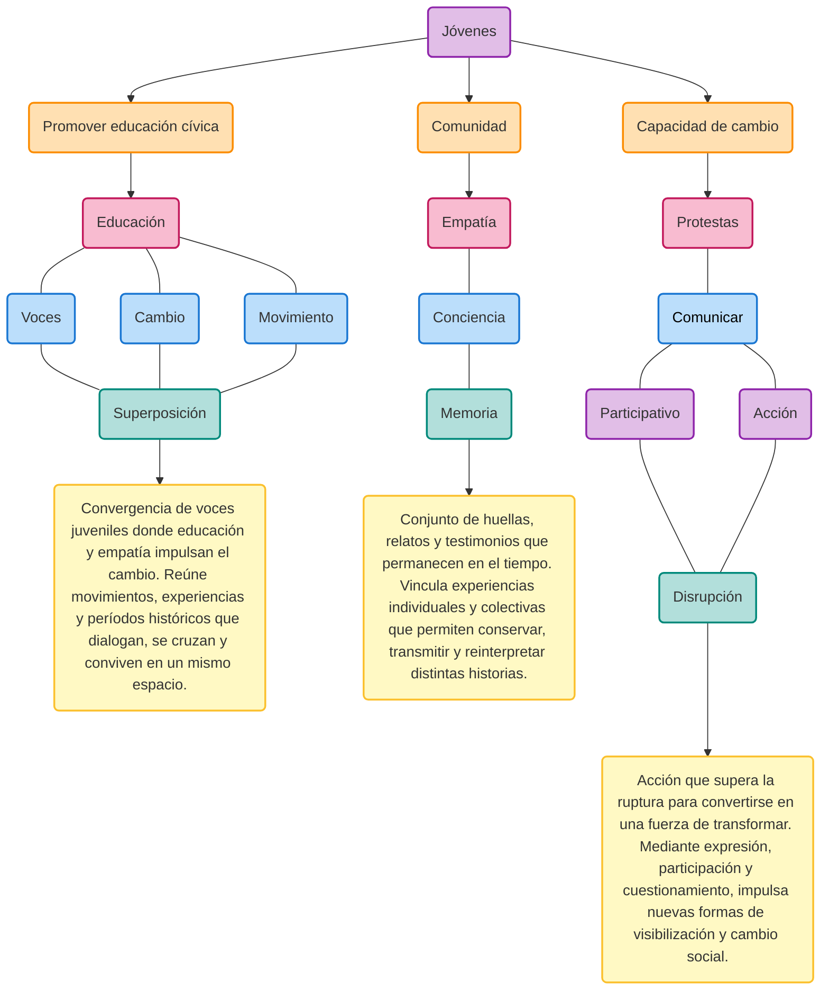

# Un Siglo de Voces Juveniles

`Contexto:` La exposición aborda la participación infantojuvenil en la historia de Chile entre 1907 y 2006, mostrando su presencia en organizaciones sociales, espacios escolares y movimientos estudiantiles. A través de casos como el movimiento scout, los niños cristaleros, principios de actividades escolares como consejos escolares y movilizaciones como el Mochilazo y la Revolución Pingüina, la muestra evidencia el rol activo de niños, niñas y jóvenes en procesos sociales.

La propuesta se plantea como una experiencia inmersiva y participativa, dispositivos interactivos que permiten comprender los distintos contextos históricos mediante un recorrido por zonas interconectadas.

### Objetivos

`General:` La propuesta expositiva busca visibilizar a las juventudes como agentes de cambio en la historia de Chile mediante un recorrido no cronológico, donde distintas épocas se presentan a través de diferentes actividades que evidencian continuidades y disrupciones a lo largo de la historia, fomentando la identificación y el sentido de pertenencia, motivando a los visitantes a reconocer su propia capacidad de generar cambios. Se materializa en un sistema expositivo que toma como referencia el sistema de estandarización escolar, transformando distintos tipos de evaluación en instancias de participación colectiva. Además, propone interacciones donde cada acción tiene como propósito que los jóvenes reconozcan distintas maneras de participación infanto juvenil durante el siglo XX y puedan identificarse con ellas. 

`Específicos:`

1. Representar los distintos hitos de la participación infantojuvenil en Chile mediante un recorrido no cronológico que evidencie sus continuidades, transformaciones y su impacto en la sociedad.
2. Generar experiencias interactivas que involucren al visitante de manera activa, permitiéndole reflexionar sobre su propia capacidad de participación y transformación social.
3. Promover la apropiación del espacio expositivo mediante elementos transformables que permitan al visitante asumir un rol activo y protagonista en cada actividad. 

